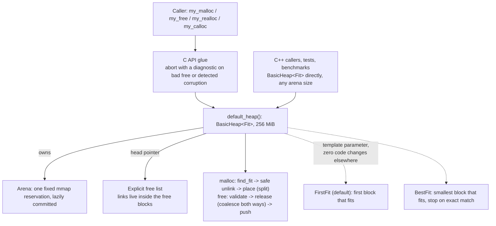

<h1 align="center">Custom Memory Allocator</h1>

A heap allocator built from scratch in C++17: `my_malloc`, `my_free`, `my_realloc` and `my_calloc` on one `mmap`'d arena. It uses an explicit free list, block splitting, O(1) boundary-tag coalescing, first-fit and best-fit policies chosen at compile time, and hardening against use-after-free writes. Single-threaded by design (see Limitations & Non-Goals below). Every performance claim here rests on three things:
- a heap invariant checker that passes after every operation of the stress tests;
- deterministic footprint measurements;
- real hardware counters from Apple Instruments, not just a wall-clock number.

<p align="center">
  <a href="#features">Features</a> ·
  <a href="#system-architecture">Architecture</a> ·
  <a href="#engineering-decisions-that-mattered">Engineering Decisions</a> ·
  <a href="#the-comparative-study">Results</a> ·
  <a href="#local-development-initialization">Build & Run</a>
</p>

## Features

*   **Free-list design.** The free list is explicit, intrusive and doubly linked: `next`/`prev` live inside free blocks, with no separate bookkeeping structure. Headers are 8 B, payloads 16 B-aligned, blocks at least 32 B.
*   **Splitting and coalescing.** Oversized free blocks are split on allocation. Coalescing is O(1) in both directions, using size-only footers on free blocks plus a prev-allocated header bit, so allocated blocks carry no footer at all.
*   **`realloc` and `calloc`.** `realloc` shrinks in place, grows in place into a free successor, and otherwise moves. A failed `realloc` leaves the original block valid and untouched. `calloc` checks the size multiplication for overflow.
*   **Two fit policies behind one template.** `BasicHeap<FirstFit>` (the default) and `BasicHeap<BestFit>` share every line of code except the search, chosen at compile time with no runtime branch.
*   **Use-after-free hardening.** A write through a dangling pointer can never make the allocator read outside its arena or loop forever. Free-list links are validated before being followed, unlinking checks both neighbours first, and walks are bounded. Detected corruption stops the heap with a clear diagnostic instead of a segfault later.
*   **Strict checks at the API boundary.** Double frees, pointers outside the arena, misaligned pointers and requests too large for the arena (including `calloc` overflow) are rejected. Bad frees abort with a named diagnostic; oversized requests return `NULL`.
*   **198 test runs.** 99 tests, built twice (once per fit policy). They cover behaviour, a randomised stress suite that checks every heap invariant after *every* operation, a 300-seed use-after-free fuzz test, and C API integration running `std::vector`, `std::map` and `std::basic_string` on the allocator. All pass under AddressSanitizer + UBSan. The allocator core has 99.7% line and 100% function coverage.
*   **The checks are themselves tested.** 11 deliberate mutations (an invariant, a merge, a hardening check broken on purpose) each confirmed that a test fails, except one, which showed a hardening check was redundant; it was removed.
*   **Measured, not argued.** Deterministic footprint measurements and a trace-replay timing harness compare against the macOS system allocator, with its small-object fast path as a control. Instruments profiles (Time Profiler attributed through inlining, plus the CPU Counters bottleneck breakdown) explain *why* the numbers look the way they do.

## System Architecture

Templates instead of virtual functions, all the way down. `BasicHeap<Fit>` owns an `Arena` and the head of an intrusive free list that lives inside the free blocks themselves. Swapping the fit policy changes one template argument: no virtual call, no code change elsewhere. The C API is a thin layer over one process-wide heap. C++ code and the tests use `BasicHeap` directly, with any arena size.



```
allocated: [ header 8B ][ payload ............................ ]
free:      [ header 8B ][ next 8B ][ prev 8B ] ...... [ footer 8B ]
header word = block size (multiple of 16) | alloc bit | prev-alloc bit
```

## Tech Stack

| Layer | Choice |
| :--- | :--- |
| Language | C++17 |
| Build System | CMake, with GoogleTest v1.17.0 fetched via `FetchContent`; arm64 forced on Apple Silicon |
| Testing | GoogleTest: 99 tests across 10 files, built once per fit policy (198 runs) |
| Sanitizers | AddressSanitizer + UndefinedBehaviorSanitizer (`MYALLOC_ASAN`, `MYALLOC_UBSAN`) |
| Coverage | clang source-based coverage (`llvm-cov`): allocator core 99.7% lines, 100% functions |
| Benchmarking | Custom trace-replay wall-clock harness (batch timing, median + IQR over 15 reps) and a deterministic footprint probe |
| Profiling | Apple Instruments via `xctrace`: Time Profiler (attributed through inlining with `atos -i`) and CPU Counters bottleneck breakdown |
| CI | None yet: everything runs locally through `bench/scripts/` (see Code Quality) |

## Engineering Decisions That Mattered

Four decisions from the [Architecture Decision Log](docs/README.md) that shaped this project the most, each with what was actually measured, not just argued for.

### 1. Shipping a Phase That Made Things Worse, Then Fixing It With Coalescing

**Problem**: Phase 1 reused freed blocks whole, so a 16 B request could consume a 4 KiB block. Internal overhead reached 7.0×, and the app-like workload ran out of a 32 MiB arena while only 4.7 MB was requested.

**Approach**: Add splitting alone first (Phase 2), keeping coalescing for the next phase so each change could be measured on its own.

**Result**: Splitting fixed internal waste (7.0× → 1.01×), but out-of-memory failures rose from **0 to 9,293** on random sizes. The arena ended up 16.2 MB free but in 82,197 pieces, the largest only 1,232 B. On the time axis the phase couldn't finish a 1M-op benchmark run in 80 minutes. Coalescing (Phase 3) took failures to **0 on every workload** and utilisation on the phase-shift workload from 0.134 to **0.997**.

**Tradeoff**: Shipping a phase that is worse on one axis looks bad in isolation. But it's the only way the before/after of coalescing is attributable to coalescing. See [ADR-005](docs/adr/005-splitting.md) and [ADR-006](docs/adr/006-coalescing.md).

### 2. An Invariant Checker That Is Itself Tested

**Problem**: Allocator bugs corrupt the heap silently, and the crash appears thousands of operations later. ASan can't see corruption *inside* an `mmap`'d arena (and wasn't even usable on this machine until the toolchain changed).

**Approach**: `Heap::check()` walks every block and the free list and verifies every structural invariant: block sizes and alignment, footers, prev-alloc bits, no two adjacent free blocks, free list ↔ heap walk agreement, counters. The stress tests call it after **every** operation and verify per-block fill patterns before each free. Then the checker itself was **mutation-tested**: code it should catch was broken on purpose, 11 times across the project.

**Result**: Removing the backward merge fails 14 tests with `adjacent free blocks`. A stale prev-alloc bit fails 23. A truncated `realloc` copy produces 7,728 `realloc lost data` reports. One hardening check removed this way failed *no* test; it was redundant and was deleted.

**Tradeoff**: Per-operation checking makes the stress tests effectively quadratic in heap size, so their workloads are sized to keep the suite fast. It only runs in test builds; benchmarks never call it. See [ADR-004](docs/adr/004-verification-strategy.md).

### 3. A Controlled Experiment Instead of a Story

**Problem**: In-place `realloc` copied 55% fewer bytes than always-move, but its footprint was **2.1×** larger on a buffer-growth workload, and it grew without bound as the arena grew. The first hypothesis (in-place *shrinking* pins small blocks) was tested with a control policy and **refuted**: it explained only about a quarter of the gap.

**Approach**: Change exactly one variable, the fit policy (first-fit → best-fit), and rerun the identical workload.

**Result**: Under best-fit the gap shrank from 2.1× to **1.01×**. The bloat was an interaction with LIFO first-fit, not a property of in-place `realloc`, which stayed, and is 1.2× faster than always-move. The same experiment confirmed why app-like utilisation was only 0.310 under first-fit: best-fit reaches **0.849**.

**Tradeoff**: Best-fit pays for that memory with a full-list scan: 57–219 nodes visited per malloc vs. ~2 for first-fit, which makes it 3–13× slower. First-fit stays the default; size-segregated lists are the structural fix. See [ADR-007](docs/adr/007-realloc-and-calloc.md) and [ADR-009](docs/adr/009-first-fit-vs-best-fit.md).

### 4. Hardening Tuned by Measurement, Not Guesswork

**Problem**: The requirement said a use-after-free write must not crash the allocator's bookkeeping. One 16-byte write into a freed block followed by `malloc` → **segmentation fault**.

**Approach**: Validate every link before following it, check both neighbours before unlinking, bound every walk, and stop with a diagnostic on detected corruption. Then measure the cost and remove what it shows to be unnecessary.

**Result**: Four measured iterations took best-fit's overhead from **+66–78%** to **+7–9%**, and found two specific costs. A footer check cost a cache miss per node, and dropping it took the adversarial overhead from +38% to ~0%. The per-node search check was best-fit's whole overhead. A 300-seed use-after-free fuzz test runs without a crash or hang under both policies and under ASan.

**Tradeoff**: First-fit still pays **~+28%** on typical workloads. The CPU Counters profile shows that this is extra retired instructions (+3.07 G useful slot-cycles) on the free path, not cache misses or mispredicts. That cost flipped app-like from 1.12× faster than libmalloc to 1.14× slower. See [ADR-012](docs/adr/012-use-after-free-hardening.md) and [ADR-010](docs/adr/010-profiling-findings.md).

## Benchmarking

Four synthetic workloads, each isolating a different behaviour:
- random sizes, 16 B–64 KiB;
- app-like: 95% ≤ 256 B, 5% up to 256 KiB;
- an adversarial trace that puts 2,000 non-fitting holes in front of every exact-fit block;
- buffer growth through `realloc`.

Each workload is a **pre-generated, seeded op trace**, so RNG cost is never timed and every allocator replays the identical sequence.

The Apple Silicon timer ticks every ~41.7 ns, about the cost of one `malloc`, so operations are timed in **batches of 1,024**, never individually. Each heap rep gets a fresh arena **pre-faulted to the trace's high-water mark**, so this allocator doesn't pay first-touch page faults that the warm system allocator doesn't. Every run does an untimed warm-up, then 15 timed reps, reported as **median with IQR**. Max − min was dominated by single outlier reps on this machine.

Three measurement problems were found and fixed along the way, all documented in [ADR-008](docs/adr/008-benchmark-methodology.md):
- **An inherited setting changed the baseline.** The editor exported `MallocNanoZone=0`, which silently switched off libmalloc's small-object fast path. The scripts now set it explicitly on every run.
- **The installed CMake built for x86_64.** Every build ran under Rosetta translation until this was caught. CMake now forces arm64, and the harness refuses to run translated.
- **Max − min hid real stability.** One row showed a max − min spread of 55% with an IQR of 1.2%, so IQR is the noise criterion now.

**Environment**: Apple M2 (arm64), macOS 26.5.2, Xcode Apple clang 21, `-O3 -DNDEBUG`, AC power, no other significant load (machine state recorded per run in [`docs/results/`](docs/results/)).

## Baseline Performance (Phase 1)

The first working version uses an explicit free list with first-fit, reuses freed blocks *whole* (no splitting) and has no coalescing. Fresh memory comes from a bump pointer. It is deliberately simple and correct, not optimised yet.

| Workload | Median | Batch p99 | Internal overhead | Notes |
| :--- | :--- | :--- | :--- | :--- |
| **Random sizes** | 15.1 ns/op | 95 ns | 3.83× | the fastest median of any version, paid for in memory |
| **App-like** | (26.0 ns/op) | 122 ns | **7.00×** | **436 failed allocations per rep even in 256 MiB**, so not comparable as a speed |
| **Adversarial** | 2,000.5 ns/op | 8.0 µs | – | free list grows every round, averaging 3,039 blocks at each malloc |

Phase 1's random-size median beating every later version is why the comparative study measures memory alongside time: its speed is bought with a 3.8–7× waste of memory and with out-of-memory failures.

## The Comparative Study

The allocator was built one variable at a time, and each phase was verified by the full test suite and the invariant checker before being measured. Full detail is in the [Architecture Decision Log](docs/README.md); the short version:

*   **Phase 2, splitting:** internal overhead 3.83–7.00× → **1.00–1.02×**. But with no coalescing, out-of-memory failures rose **0 → 9,293** on random sizes, the free list shredded into 107,655 pieces, and **the phase could not finish a timing run in 80 minutes**. Splitting without merging is a measured regression, kept on purpose so the next phase's effect is attributable ([ADR-005](docs/adr/005-splitting.md)).
*   **Phase 3, coalescing:** out-of-memory failures **0 on every workload**. Utilisation on random sizes 0.099 → **0.615**, on phase shift 0.134 → **0.997**. The adversarial workload is **2.9× faster than Phase 1**, because its free list stays at 358 blocks instead of growing to 3,000+. Coalescing costs ~0.8 ns/op against Phase 1 on random sizes and cuts the batch p99 from 95 to 26 ns ([ADR-006](docs/adr/006-coalescing.md)).
*   **Phase 4, `realloc`/`calloc`:** the allocation paths were refactored into shared `place()`/`release()` helpers, with byte-identical footprint output, and timing is unchanged within noise. In-place `realloc` is **1.2× faster than always-move** ([ADR-007](docs/adr/007-realloc-and-calloc.md)).
*   **Phase 6, best-fit variant:** **2.7× less memory on app-like** (utilisation 0.310 → 0.849), but **12.8× slower on random sizes**. First-fit visits ~2 free blocks per malloc and best-fit 57–219. First-fit stays the default ([ADR-009](docs/adr/009-first-fit-vs-best-fit.md)).
*   **Hardened (current):** use-after-free safety for **+28% on first-fit** typical workloads and **+1% on adversarial**, with byte-identical footprint ([ADR-012](docs/adr/012-use-after-free-hardening.md)).

All versions measured back-to-back in one invocation of `bench/scripts/run_phases.sh` (first-fit; median ns/op; IQR ≤ 5.6% except where marked; [data](docs/results/final/timing-summary.md)):

| Workload | Phase 1 | Phase 2 | Phase 3 | Phase 4 | Phase 6 | **Hardened** |
| :--- | :--- | :--- | :--- | :--- | :--- | :--- |
| Random sizes | 15.08 | untimeable | 15.86 | 15.93 | 16.06 | **20.63** |
| App-like | 26.03 (436 OOM/rep) | untimeable | 16.49 | 16.59 | 16.66 | **21.27** |
| Adversarial | 2,000.5 | untimeable | 685.5 | 681.0 | 632.9 | **640.1** |
| `realloc` growth | – | – | – | 26.53 | 28.16 | **39.15** (noisy, IQR 10.4%) |

Memory (deterministic footprint probe; utilisation = peak live bytes ÷ arena high-water; OOM = failed allocations):

| Workload | Phase 1 | Phase 2 | Phase 3–Hardened (first-fit) | Best-fit |
| :--- | :--- | :--- | :--- | :--- |
| Random sizes | 0.242 | 0.099, **9,293 OOM** | 0.615 | **0.913** |
| App-like | 0.142, **1,035 OOM** | 0.142, 549 OOM | 0.310 | **0.849** |
| Phase shift | 0.589 | 0.134, 226 OOM | **0.997** | **0.997** |

**Against the system allocator** (same final session, separate invocation; [data](docs/results/final/timing-summary.md)):

| Workload | libmalloc | libmalloc, Nano zone off | **This allocator (first-fit)** | |
| :--- | :--- | :--- | :--- | :--- |
| Random sizes | 29.88 | 29.02 | **22.63** | 1.32× faster |
| App-like | **18.75** | 21.62 | 21.36 | 1.14× slower; level with libmalloc once its Nano fast path is off |
| Adversarial | **12.37** | 13.65 | 653.28 | 53× slower |
| `realloc` growth | 37.51 | 43.39 | **33.93** | 1.11× faster |

libmalloc is thread-safe and pays for it, while this allocator is single-threaded. Part of any lead here is that, not better design.

## Bottlenecks

What still limits this allocator, as measured, not guessed at ([ADR-010](docs/adr/010-profiling-findings.md)):

*   **The free path, not the search, dominates typical workloads.** `release` plus unlinking take ~51% of the time; the free-list search ~10%. LIFO first-fit visits only ~2 of the 855–1,610 free blocks per malloc.
*   **Branch mis-speculation.** ~37–52% of pipeline slots are discarded on random-size workloads: every operation is ~50 cycles of data-dependent decisions. This includes the harness's own unpredictable alloc/free dispatch; the counter samples can't separate the two.
*   **No small-object fast path.** That is why libmalloc wins app-like by 14%: with its Nano zone off they are level.
*   **One free list.** The adversarial workload is 98% search and 80% stalled on memory: a pointer chase through 2,000 cold holes per request, which size-segregated lists would never visit. That is 53× slower than libmalloc.
*   **Measurement limits.** Cross-run drift is up to ~10%, so only same-run comparisons are trusted. The ~41.7 ns timer means per-call latency isn't observable, only 1,024-op batches. There is no core pinning on macOS.

## Limitations & Non-Goals

These are scope boundaries, not oversights (see [docs/plan.md](docs/plan.md)):

*   **Single-threaded.** No locks or per-thread caches. The code contains no concurrency primitive at all.
*   **One fixed 256 MiB arena behind the C API.** It never grows, and freed memory is never returned to the OS.
*   **No size-segregated free lists or small-object slab.** These are the two structural fixes the measurements point at, held as stretch goals.
*   **Use-after-free hardening guarantees memory safety and termination, not detection**, and is not a defence against a deliberate attacker. Free-list pointers aren't mangled or checksummed.
*   **Not a drop-in system `malloc`.** No `operator new` hook or symbol interposition.
*   **One machine, one baseline.** Measured on an Apple M2 against macOS libmalloc only; glibc was not measured.

## Testing

99 tests across 10 files, each built twice: `myalloc_tests` (first-fit) and `myalloc_tests_bestfit` (best-fit as the default, C API included), so **198 runs**.

*   **Unit tests:** alloc/free and reuse order, split arithmetic and thresholds, merges in each direction, prev-alloc bit maintenance, every `realloc` path (shrink, grow in place, move, failure leaves the original intact), `calloc` zeroing and overflow, alignment for every size 0–600, fit-policy choices with exact search-step counts.
*   **Randomised stress:** seeded alloc/free/realloc mixes with the heap invariant checker after **every** operation and fill patterns verified before every free. One configuration uses a 64 KiB arena to keep the out-of-memory path constantly exercised. Every seed must end with the arena back to one free block.
*   **Use-after-free:** targeted tests for each kind of metadata overwrite (garbage links, links into allocated blocks or outside the arena, cycles, bad footers), plus a **fuzz test**: 300 seeds × 3,000 ops with random writes through dangling pointers. Its real assertion is "no crash, no hang".
*   **Integration:** the C API used like a program would: linked lists, strings, a 32 MiB block, a `realloc` string builder, a `calloc` matrix, and `std::vector`, `std::map` and `std::basic_string` running entirely on `my_malloc` through an allocator adapter. Death tests check that bad frees and detected corruption abort with the right message.
*   **Mutation checks:** 11 deliberate breakages of invariants, merges, `realloc` and the hardening checks, each confirming that a test fails, except the one that exposed a redundant check (see [ADR-004](docs/adr/004-verification-strategy.md), [ADR-012](docs/adr/012-use-after-free-hardening.md)).

All 198 runs pass under UBSan and under ASan + UBSan.

**Coverage** (clang source-based, both binaries merged): allocator core 99.7% lines, 100% functions, 86.3% branches. Including the C API glue, 97.1% lines and 100% functions. The uncovered glue lines are abort diagnostics, which death tests do execute, but in child processes that `abort()` before writing profile data ([report](docs/results/coverage.md)).

## Code Quality

*   **Zero concurrency primitives.** No `std::mutex`, `std::thread`, `std::atomic` or `pthread_*` anywhere in `src/`, `include/`, `tests/` or `bench/` (verified by a full-repo grep). It is single-threaded by design, so lock ordering and data races can't occur here.
*   **Warning-clean** under `-Wall -Wextra -Wpedantic`, in Debug, Release, ASan and coverage builds.
*   **Dead code removed when found.** Coverage exposed a helper overload left unused after a hardening iteration, and it was deleted.
*   **Not set up yet:** CI, `clang-format` and `clang-tidy`. Everything above runs locally through CMake and `bench/scripts/`. A CI pipeline like the Matching Engine's is the obvious next step.

## Local Development Initialization

The project fetches GoogleTest automatically via CMake `FetchContent` on first configure (network needed once). The allocator itself has no dependencies beyond POSIX `mmap`. Developed on macOS (Xcode clang); on Apple Silicon CMake forces native arm64 builds.

```bash
# Correctness: 99 tests x 2 fit policies, with UBSan
cmake -S . -B build-test -DCMAKE_BUILD_TYPE=Debug -DMYALLOC_UBSAN=ON
cmake --build build-test -j
ctest --test-dir build-test --output-on-failure

# Same suite under AddressSanitizer + UBSan
cmake -S . -B build-asan -DCMAKE_BUILD_TYPE=Debug -DMYALLOC_ASAN=ON -DMYALLOC_UBSAN=ON
cmake --build build-asan -j && ctest --test-dir build-asan

# Release tools
cmake -S . -B build -DCMAKE_BUILD_TYPE=Release && cmake --build build -j
./build/footprint_probe                   # memory metrics, first-fit (add --best-fit)
./build/footprint_probe realloc           # realloc policy comparison
./build/freelist_length app_like          # free-list length and nodes visited per malloc

# Timing: vs libmalloc (+ Nano-off control), then every phase commit
bench/scripts/run_final.sh
python3 bench/scripts/summarize.py        # median + IQR -> docs/results/timing-summary.md

# Profiling (Instruments): see docs/results/profiles/README.md
python3 bench/scripts/profile_attrib.py <trace> <binary>
python3 bench/scripts/counters_summary.py <trace> [...]
```

Using it:

```c
#include <myalloc/myalloc.h>

void* p = my_malloc(100);       /* 16-byte aligned; NULL when the arena is exhausted */
p = my_realloc(p, 4000);        /* on failure returns NULL and p stays valid */
void* z = my_calloc(10, 8);     /* zeroed; NULL on size overflow */
my_free(p);
my_free(z);                     /* double free / invalid pointer / corruption -> abort with a message */
```

## Project Structure

```
include/myalloc/  # myalloc.h: the C API
src/              # arena (mmap), block layout, BasicHeap<FirstFit|BestFit>, C API glue
tests/            # unit, stress, use-after-free fuzz and integration tests (GoogleTest)
bench/            # timing harness + workloads, footprint probe, free-list probe
bench/scripts/    # run_all / run_phases / run_final, summarize, profile_attrib, counters_summary
docs/adr/         # architecture decision records 001-012
docs/results/     # raw CSVs, summaries, machine state per run, profiles, coverage
```

`BasicHeap` (in `src/heap.h`) is templated on the fit policy, so first-fit and best-fit are the same class instantiated twice. The benchmark scripts build *older phase commits* from `git archive` against the current harness, so every phase can be re-measured at any time.

## Documentation

The full writeup lives in [`docs/`](docs/):

*   [Project plan](docs/plan.md): scope, phases, budget, exit criteria
*   [Architecture Decision Log](docs/README.md): 11 ADRs (001–010, 012), each with alternatives considered and measured before/after numbers
*   [Testing strategy](docs/testing.md)
*   [Environment](docs/environment.md): machine, toolchain, and the toolchain incidents found along the way
*   [Results](docs/results/): every CSV behind every number in this README, with the machine state at the time

## License

MIT License. See `LICENSE` for more information.
